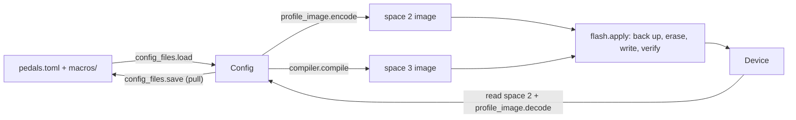

# Pedals CLI

- **Status:** draft

A `pedals` command line tool replaces the GWS IDI config app (`IDIConfig.exe`) for the Fragpedal
Quad. The repo holds the pedal config as text: `pedals.toml` plus the `.idi` macros. The tool reads
the config from the pedals, shows it, compares it with the repo, and flashes it back. It talks to the
pedals over USB HID with the same packets that `IDIConfig.exe` sends, from Windows Python, and needs
no vendor software at runtime.

The device stores its config in flash areas called spaces. Space 2 holds the profile image (names,
labels and the macro source for each pedal); space 3 holds the runtime image (the compiled bytecode
for every profile). A logged save in the vendor app, the space 3 spike, confirmed the vendor write sequence: it
leaves space 3 erased past the new runtime, so the tool repeats that sequence unchanged.

## Shape



`0d 01 <space>` selects a space; reads, erases and writes then address it from 0.

| Space | Holds | Max size | This tool |
| --- | --- | --- | --- |
| 2 | the profile image | 128 KiB | reads; `apply` writes |
| 3 | the runtime image, for **all** profiles | `0xC000` bytes | reads; `apply` writes |
| 4 | manufacturing data: serial, product text | `0x624` bytes | reads |
| 0, `0x81` | firmware | — | never selects |

## Device protocol

Every message is a 64-byte HID report on interface `vid_1095&pid_0400&mi_01` (usage page `0xFF55`),
sent with `HidD_SetOutputReport` with report ID 0 in front and zero padding. Byte 0 is the command;
the device answers with the command byte plus `0x80`. The device also sends unsolicited reports
(`a0`–`a7`: debug text, sound and display requests), which a reader skips.

| Send | Meaning | Answer |
| --- | --- | --- |
| `01` | get version | `91 …` new-style: NUL-ended text from byte 6. `81 …` old-style: from byte 2 |
| `0b` | get active profile | `8b <profile>`; profile numbers start at 1 |
| `0d 01 <space>` | select a space | `8d` |
| `02 06 <len:u16> <addr:u32>` | read; len ≤ 62 | `82 <n> <data[n]>` |
| `04 01 <profile>` | switch profile | `84` |
| `08` | stop runtime | none awaited |
| `05 01 <sector>` | erase a sector of the selected space | `85` |
| `03 <len+6> <len:u16> <addr:u32> <data>` | write; len ≤ 56; never crosses a 256-byte page | `83` |
| `09` | start runtime | `89` |

All multi-byte fields are little-endian. `docs/protocol.md` holds this table once the work is built.

## Contracts

### Command line

The WSL shim `bin/pedals` runs the package under Windows Python 3.12. Every command prints plain
text.

```text
$ pedals status
firmware   Sep 26 2020 14:06:10 Ver 1.0.8
channel    ok
profile    2 "Path of Exile"

$ pedals status        # after a reboot, before a replug
channel    no answer: replug the pedals' USB cable, then run the command again
(exit 3)

$ pedals show "Path of Exile"     # or: pedals show 2; with no argument, every profile
profile 2 "Path of Exile"
  pedal 1  Repeat Left Click   RepeatLeftClick.idi
  pedal 2  Flask Piano         FlaskPiano.idi
  pedal 3  Flask Piano         FlaskPiano.idi
  pedal 4  F8                  F8.idi

$ pedals pull          # device → pedals.toml + macros/; overwrites, git shows the change
$ pedals diff          # repo vs device
$ pedals switch 2      # or a profile name; no flash write
$ pedals apply         # compile, back up, flash, verify; asks y/N unless --yes
$ pedals restore <dir> # flash the space2.bin + space3.bin pair in <dir>
```

A profile argument that is all digits is a profile number, from 1 to the number of profiles decoded
from space 2. Any other argument matches one profile name exactly, case included.

| Exit | Meaning |
| --- | --- |
| 0 | ok |
| 1 | `diff` found a difference |
| 2 | bad argument: unknown profile, a name two profiles share, missing backup dir |
| 3 | no device: MI_01 not found, or no answer within the timeout |
| 4 | bad repo input: `ConfigError`, `CompileError`, image over its size limit |
| 5 | flash verify failed after an erase |
| 6 | refused: `IDIConfig.exe` runs, old-style firmware |
| 7 | bad device data: bad image header, a macro in slot 5–8, a `pull` conflict |

When two codes apply, the lower one wins.

### `pedals.toml`

`pedals.toml` and `macros/` hold every space 2 field that a person edits. `pull` followed by
`apply` keeps every other field the device needs, through the rules under
the Space 2 format part of [Constraints](#constraints).

```toml
owner = "Your Name Here"                     # tag 0x01

[files]
aliases = "Windows Aliases.txt"              # tag 0x11
macros = "Windows Macros.txt"                # tag 0x12

[[profile]]                                  # order = profile number; 1 to 5 profiles
name = "Path of Exile"                       # tag 0x04
image = "gradient.png"                       # tag 0x10; optional
settings = "6464000000000000000f0f0f0000000000000000000000000000000000"   # tag 0x03, 29 bytes

  [[profile.pedal]]                          # order = pedal number; 1 to 4
  macro = "RepeatLeftClick.idi"              # tag 0x06 file name; the file's bytes are tag 0x07
  label = "Repeat Left Click"                # tag 0x0b
  description = "Repeat Left Click"          # tag 0x0c; omit = no record

[[record]]                                   # each record of a tag no module models
tag = 0x13
profile = 5                                  # the record's a byte
data = "00"
```

### Python modules

Each module owns the types it shows. Code outside a module uses only these names. One top-level
handler in the CLI maps each exception to its exit code.

```python
# hid module. Adapters: WindowsHid (ctypes over hid.dll + setupapi.dll; imported only on Windows),
# FakeHid for tests.
class HidChannel(Protocol):
    def send(self, payload: bytes) -> None: ...   # ≤ 64 bytes
    def recv(self, want: set[int], timeout_s: float = 2.0) -> bytes: ...
    # the first report whose byte 0 is in `want`; skips the rest; raises NoAnswer on timeout
```

```python
# device module: one method per command. The only module that builds packets.
dev = Device(WindowsHid.open())          # raises DeviceNotFound
dev.version()                            # → Version(text='Sep 26 2020 14:06:10 Ver 1.0.8', new_style=True)
dev.read(space=2, addr=0, length=0x54)   # → 84 bytes

class Device:
    def version(self) -> Version: ...
    def active_profile(self) -> int: ...
    def read(self, space: Literal[2, 3, 4], addr: int, length: int) -> bytes: ...
    # selects the space on every call; asks for ≤ 62 bytes at a time and continues from
    # addr + n after a short answer; an answer of 0 bytes raises NoAnswer
    def switch_profile(self, n: int) -> None: ...
    # write side, for the flash module only:
    def stop_runtime(self) -> None: ...
    def erase(self, space: Literal[2, 3], sector: int) -> None: ...
    def write(self, space: Literal[2, 3], addr: int, data: bytes) -> None: ...
    def start_runtime(self) -> None: ...
```

```python
# profile_image module: space 2 bytes ⇄ Config
config = profile_image.decode(space2_bytes)
# → Config(owner='Your Name Here', profiles=[Profile(name='Path of Exile', …), …])
space2_bytes = profile_image.encode(config)

@dataclass
class Config:
    owner: str
    serial: str                  # tag 0x02; read only; never in pedals.toml
    files: dict[str, str]
    profiles: list[Profile]
    extra: list[Record]          # records of unmodelled tags, in device order

@dataclass
class Profile:
    name: str
    settings: bytes              # 29 bytes, opaque
    image: str | None
    pedals: list[Pedal]          # 4 entries; the device's slots 5–8 are always empty

@dataclass
class Pedal:
    macro: str | None            # None = empty slot; tag 0x05 follows from it
    source: bytes | None         # the .idi file's bytes; no trailing NUL
    label: str | None
    description: str | None      # None = no tag 0x0c record

@dataclass
class Record:                    # wire form: tag u8, a u8, b u8, c u8, len u16, data[len]
    tag: int
    a: int                       # profile number on profile and pedal records
    b: int                       # slot number on pedal records
    c: int                       # 0x08 on the tag 0x05 record of a used slot
    data: bytes
```

```python
# config_files module: Config ⇄ pedals.toml + macros/
config = config_files.load(repo_root)    # raises ConfigError(file, key, message)
config_files.save(config, repo_root)
```

```python
# compiler module
runtime = compiler.compile(config)       # → bytes: the whole space 3 image
# raises CompileError(file='SpamClick.idi', line=12, message='unknown builtin Beep')
```

```python
# flash module: the only caller of the Device write side
flash.apply(dev, space2=…, space3=…)    # → BackupDir; raises VerifyFailed(backup_dir)
flash.restore(dev, backup_dir)
```

### Space 2 image

```text
0x00  u32  magic        0x86754232; anything else is exit 7
0x04  u32  version      1; anything else is exit 7
0x0C  u32  record-area length; decode reads 0x54 + this many bytes
…          more header fields: record count, per-profile offsets
0x54  …    records
```

| Tag | Level | Data |
| --- | --- | --- |
| `0x01` owner, `0x02` serial | global | string |
| `0x03` settings, `0x04` name, `0x10` image | profile | 29 bytes, string, string |
| `0x05` slot kind | pedal | 1 byte: `0x08` used, `0x00` empty |
| `0x06` file, `0x07` source, `0x0b` label, `0x0c` description | pedal | string |
| `0x11` aliases file, `0x12` macros file | trailer | string |

The builder pins the remaining header fields from the vendor exe (`parseProfileImage`) and the dumps
in `pedal-restore\`, and records them in `docs/image-format.md`. No bytes from a real dump go into
the repo, apart from the golden pair.

### Runtime image (space 3)

```text
0x00  u32  magic        0xDEAD0BF0
0x04  u32  length       whole image, bytes
…          thread table (profile mask, code offset, 0), procedure table, string table
…          bytecode
```

The builder works out the layout from the vendor exe (near `RuntimeImage %d RAM footprint %d`) and
the golden pair.

### Supported macro language

The compiler accepts this subset of IDI and rejects anything else with `CompileError`:

```text
PROCEDURE <name> … RETURN END        THREAD <name> … END        <label>:   GOTO <label>
DO … WHILE (<expr>)                  <proc>()
<expr>:   literals (decimal, 0x hex), Button, ButtonMask, GetButtonState, ( ), &, ==
builtins: WaitForButton(a, b)  DelayForMs(n)  KeyActionHid(mod, key, action)
          MButton(a, b, c, d)  TypeText("text", delay_ms)
comments: // to end of line
```

`KeyActionHid` action values: `1` press, `0` release.

## Constraints

**Device safety**

- `Device` takes the space as a `Literal` argument on every space command, so no code path can
  select space 0 or `0x81`.
- No code sends a firmware command (`06`, `17`).
- Every command sends `01` first. An `81` answer stops it with exit 6 after `status` prints the
  version, and before anything else goes out.
- `status`, `show`, `pull`, `diff` and `switch` send only `01`, `0b`, `0d`, `02` and `04`.
- Every command refuses with exit 6 while `IDIConfig.exe` runs: both programs read the same reports,
  so either one can lose answers.

**Flash**

- The write sequence is the vendor app's, as the spike recorded it: `08`; `0d 01 02`; `05 01 00`; `05 01 01`; space 2 writes; `0d 01 03`; space 3 writes; `09`;
  `04 01 <profile active before the write>`.
- Before the first erase, `flash` reads spaces 2 and 3 in full into
  `C:\Users\Public\Public Hardware\GWS\pedal-restore\<timestamp>\space2.bin` and `space3.bin`.
- After each write, `flash` reads the chunk back and compares it. A mismatch from a lost or garbled
  HID report gets the same chunk written again, up to 3 times, as the vendor app does. After that,
  `flash` raises `VerifyFailed`, prints the backup path and the `pedals restore` command, and exits 5.
- A config whose images pass 128 KiB (space 2) or `0xC000` bytes (space 3) fails with exit 4 before
  any device I/O. The two erases cover 2 sectors of 64 KiB.

**Space 2 format**

- Strings and sources are cp1252, stored with one trailing NUL; decode strips it and encode adds it.
- An empty slot is a tag 0x05 record with data `0x00` and c = 0, plus a tag 0x06 record with an
  empty string.
- Encode writes records in device order: tags 0x01 and 0x02; then per profile tag 0x03, 0x04, 0x10,
  and per slot 1–8 tags 0x05, 0x06, 0x0b, 0x0c, 0x07; then tags 0x11 and 0x12 with a = the last
  profile number; then each `extra` record at the end of the block of profile `a`, or after the
  trailer when `a` is past the last profile.
- Encode writes a, b and c from the meanings in `Record` and writes every other a, b and c as 0; the
  vendor app leaves them uninitialised.
- Decode fails with exit 7 when slot 5–8 holds a macro, a label or a description.
- `config_files.load` rejects more than 5 profiles or more than 4 pedals in a profile.
- `decode(encode(decode(img))) == decode(img)` for every image, and `encode(decode(img))` equals
  `img` except for the zeroed bytes above.

**Repo and diff**

- `config_files.save` writes macro files byte for byte; `.gitattributes` marks `*.idi -text`.
- `pull` fails with exit 7 when two pedals name one macro file with different source bytes, and
  names both pedals.
- `pull` writes only the files that pedals name. It deletes nothing. `diff` notes each `.idi` in
  `macros/` that no pedal names, and the note leaves the exit code alone.
- `diff` compares decoded `Config` objects: owner, files, each profile, each pedal (macro, source
  bytes, label, description) and `extra`. It skips serial and the zeroed header bytes. It does not
  read space 3: `apply` always rewrites both spaces together.

**Tests**

- CI runs the tests on Linux with `FakeHid`. The unit tests use an invented space 2 image, built from
  `Record` values in the test.
- The golden pair in `pedals/test_fixtures/golden/` holds one profile, Generic, with two macros,
  and the serial `F00000000`. It comes from the vendor-app save in the space 3 spike. It covers
  every statement of the supported language except `TypeText`.
- `compiler.compile(decode(golden space 2))` equals the golden space 3 image, byte for byte.

## Decisions

- **The tool is a Python package that runs under Windows Python 3.12.** Only Windows reaches the
  device, and `ctypes` reaches `hid.dll` with no install.
- **The repo is the source of truth; the device is a build output.** `pull` bootstraps the repo and
  recovers from edits made in the vendor app.
- **A full flash is the only write.** It sends the vendor app's sequence; nothing shows that the
  firmware accepts a partial write.
- **Switching profile never writes flash.** Space 3 holds every profile, so `04 01 <n>` is enough.
- **The compiler matches the vendor compiler byte for byte, for the subset the current macros use.**
  Byte equality with the golden pair is the only proof available without a test write to the
  pedals; more vendor-saved pairs extend the subset.

## Delivery

| PR | Builds | Device use while building |
| --- | --- | --- |
| Read and switch | `hid`, the `device` read side, `profile_image.decode`, `config_files`; `status`, `show`, `pull`, `diff`, `switch`; `bin/pedals`; `docs/protocol.md`; space 2 in `docs/image-format.md`; a CI job for the tests | reads and `switch`, with the active profile put back after; `IDIConfig.exe` closed |
| Repo restructure | one `pedals pull`, committed as `pedals.toml` + `macros/`; the file moves; the README rewrite; the agent skill | one `pull` |
| Compile and write | `profile_image.encode`, `compiler`, the `device` write side, `flash`; `apply`, `restore`; `docs/language.md`; space 3 in `docs/image-format.md` | reads; a first write of the restore dump, with the owner's go-ahead |

The repo after the restructure:

```text
README.md      pedals.toml      pyproject.toml      .gitattributes      .gitignore
bin/pedals     macros/          macros/templates/   reference/          pedals/
tests/         docs/            .claude/skills/pedals/SKILL.md
```

- Where a root `.idi` file and the device disagree, the device copy wins. A root `.idi` file that no
  pedal names moves to `macros/` unchanged. `templates/` becomes `macros/templates/`.
- `Windows Macros.txt` moves to `reference/`. The `.gitignore` drops its vendor-template patterns.
- The README drops its copy-into-`IDI Device\macro` install step and its `KeyActionHid` notes, and
  links the docs and the CLI.
- The skill tells an agent how to run the CLI from WSL, how to fix the replug state, and that
  `apply` needs the owner's go-ahead.

## Builder decides

- Internal names, the layout inside `pedals/`, and helper functions.
- How `bin/pedals` finds Windows Python and converts paths, and how the CLI finds the repo root.
- How the CLI detects a running `IDIConfig.exe`.
- The TOML writer, the test runner and the test layout.
- The wording of messages and the `show`, `status` and `diff` output formats.
- How `hid` handles overlapped I/O and buffering.

## Out of scope

- Firmware updates. No code path reaches them.
- Host-side runtime features: sounds, on-screen display, streaming text (reports `a0`–`a7`). They
  need a resident Windows process.
- Old-style firmware, which uses fixed flash addresses.
- The vendor app's macro builder and alias files.
